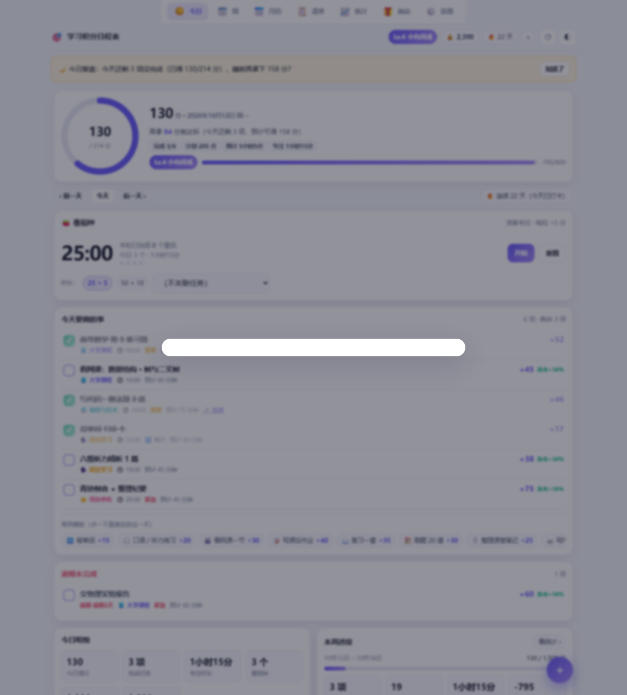
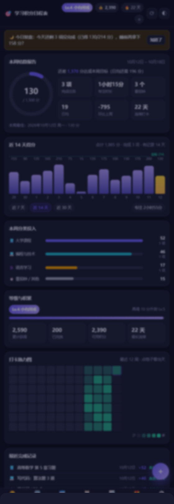

# 学习积分日程表

一个给自己用的「任务清单 + 积分激励」网页程序：电脑和手机都能打开，数据默认存在本机，配好 GitHub Gist 后两端自动同步。

**第一次使用请看 → [部署指南.md](部署指南.md)**（从零到手机上装好，约 10 分钟）

---

## 它长什么样

| 电脑端 | 手机端（深色 + 统计页） |
| --- | --- |
|  |  |

---

## 核心玩法：积分学习法

| 机制 | 默认设置 | 说明 |
| --- | --- | --- |
| 每项任务的分值 | 自己填（快捷按钮 10~100） | 常用任务可存成模板，一键套用 |
| 每周目标 | 1500 分 | 每天约 214 分自动折算 |
| 连击加成 | 连续打卡每天 +5%，上限 +50% | **断签不清零**，只是重新累计，不制造焦虑 |
| 等级 | 500 分升 2 级，每级递增 100 | 称号：初醒 → 起步 → 习惯养成 → … → 传说 |
| 番茄钟 | 25+5 或 50+10，每段 +5 分 | 可关闭加分 |
| 奖励商店 | 奶茶 200 / 小吃 150 / 看剧 250 / 大餐 400 / 半天放飞 350 / 小东西 500 | 花积分兑换，可撤销 |

积分分三个数字：**累计获得**、**已兑换**、**可用**（可减去兑换，兑换后可用会减少）。

---

## 功能清单

- **今日**：进度环（今日得分 / 每日目标）、任务清单（含积分与连击加成预览）、逾期提醒、番茄钟、常用模板一键添加
- **周视图**：周一到周日按天分组，每天显示得分与完成进度，可给任意一天加任务
- **月历**：整月得分深浅着色 + 任务圆点，点任意一天看当天详情
- **清单**：关键词搜索、分类筛选、重复任务 / 未安排日期 / 重要任务筛选
- **统计**：本周结算报告（目标完成率、环比、最佳日）、近 7/14/30 天得分柱状图（带每日目标线）、分类投入占比、等级进度、12 周打卡热力图、最近完成记录
- **商店**：奖励管理、一键兑换、兑换记录与撤销
- **设置**：目标分值、连击规则、番茄钟（时长/加分/提示音）、每日两次提醒、分类与模板管理、多设备同步、数据导入导出、主题与主色
- **任务能力**：分类标签、四象限优先级（重要/紧急）、具体时间、预计时长、备注与资料链接、重复规则（每天 / 工作日 / 每周指定几天 / 每月同日 / 每隔 N 天 + 截止日期）
- **提醒**：程序内提醒条 + 系统通知（每日 8:00 / 21:00，时间可改）+ **导出 .ics 到手机自带日历**（带时间的任务提前 10 分钟提醒，最可靠）
- **数据**：本地优先（离线可用）、JSON 备份导入导出、CSV 积分明细导出、GitHub Gist 双向合并同步
- **PWA**：手机可「添加到主屏幕」当 App 用，支持离线打开

---

## 文件结构

```
index.html              页面骨架
styles.css              全部样式（浅色/深色自适应）
app.js                  界面主程序（七个视图 + 弹层 + 番茄钟 + 提醒 + 同步）
sw.js                   Service Worker（离线缓存 + 通知点击回到程序）
manifest.webmanifest    PWA 清单（应用名、图标、快捷方式）
404.html                网址打错时的友好提示页（找不到页面就回首页）
js/util.js              日期与通用工具
js/store.js             数据层：默认值、本地存储、同步合并
js/logic.js             核心逻辑：重复任务、积分、连击、等级、统计
js/charts.js            图表：进度环、柱状图、分类条、热力图
js/ics.js               .ics 日历导出
js/gist.js              GitHub Gist 同步
icons/                  应用图标
screenshots/            界面截图（可以不上传）
test/                   自测脚本与演示数据（可以不上传）
tools/serve.py          本地预览服务（找不到的路径自动回首页）
tools/make_icons.py     重新生成图标（可选）
```

**部署到 GitHub Pages 时只需上传**：`index.html`、`styles.css`、`app.js`、`sw.js`、`manifest.webmanifest`、`404.html`、`js/`、`icons/`。

---

## 开发与自测

```bash
# 核心逻辑自测（141 项断言：日期、重复规则、积分、连击、等级、统计、同步合并）
node test/selftest.js

# 本地预览（Service Worker 需要 http 环境，直接双击 index.html 会少部分功能）
python tools/serve.py 8931     # 找不到的路径自动回到首页，启动时会打印预览地址
# 打开 http://127.0.0.1:8931/index.html
```

界面自测：打开 `test/smoke.html`（无头浏览器或直接浏览器打开），它会自动完成一轮交互并把结果写进页面顶部的 `<pre id="smoke">`。

演示数据：打开 `test/seed.html?theme=dark&view=stats` 会写入一份示例数据并跳转到指定页面（会覆盖本机数据，慎用）。

---

## 设计取舍

- **本地优先**：没网也能记录，同步只是把本地和云端合并，不会因为同步失败丢数据。
- **合并策略**：每条记录带更新时间，冲突时以较新的为准；删除用墓碑标记传播，不会「删了又回来」。
- **无依赖**：没有框架、没有 CDN、没有第三方统计，全部是原生 HTML/CSS/JS，断网可用。
- **不制造焦虑**：连击断签不清零、逾期任务单独成区不扣分、积分可透支（显示为负数提醒你赚回来）。
